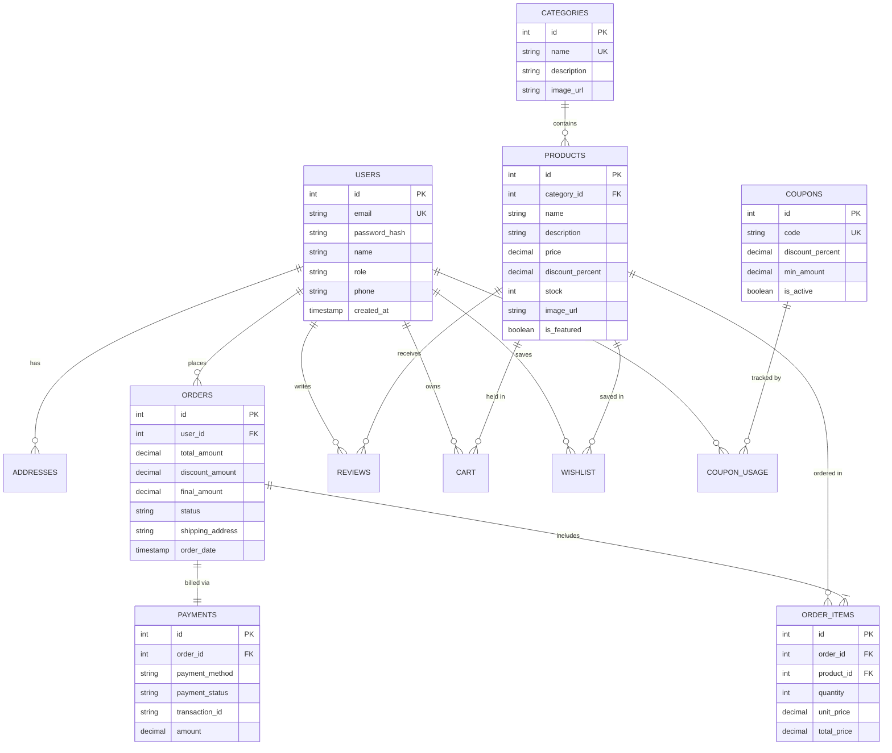
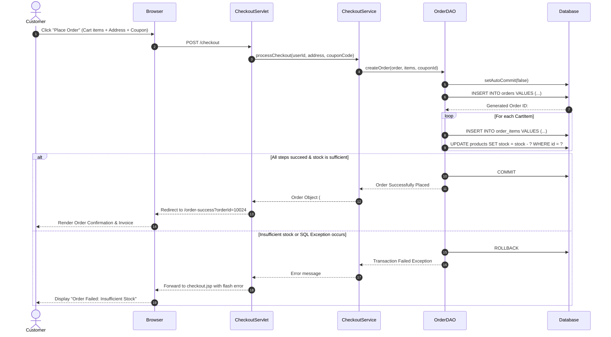
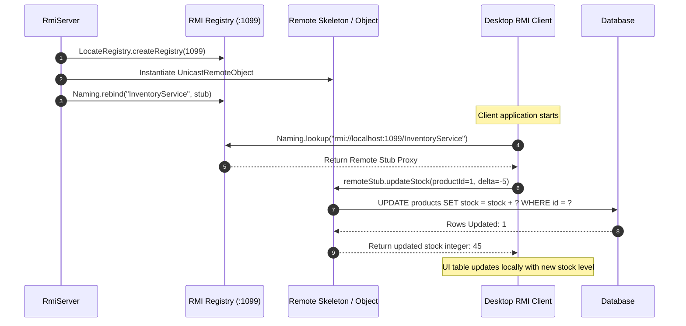

# ACADEMIC PROJECT REPORT

## **SHOPSPHERE: A DISTRIBUTED JAVA ENTERPRISE E-COMMERCE PLATFORM**
### *Fulfilling the RTU Advanced Java / Java Programming Lab Curriculum*

---

### **CANDIDATE INFORMATION & ACADEMIC DECLARATION**
* **Degree**: Bachelor of Technology (B.Tech)
* **Branch**: Computer Science and Engineering
* **University**: Rajasthan Technical University (RTU), Kota
* **Subject**: Advanced Java Lab / Java Enterprise Application Development
* **Academic Year**: 2026 – 2027

---

## 1. ABSTRACT

Modern commercial software applications demand high availability, modular separation of concerns, and interoperability across heterogeneous client devices. **ShopSphere** is a distributed enterprise e-commerce platform architected and implemented to satisfy the comprehensive learning objectives of the **RTU Advanced Java** syllabus.

The project unites three distinct software paradigms into an integrated ecosystem:
1. **Web Presentation & Business Logic Tier**: Implemented using **Jakarta Servlets 6.0**, **Jakarta Server Pages (JSP 3.1)**, **Expression Language (EL 5.0)**, **Jakarta Standard Tag Library (JSTL 3.0)**, Custom Tag Files, Servlet Filters, and Lifecycle Listeners hosted on an embedded Apache Tomcat 10.1 container.
2. **Desktop Administration Console**: Developed with **Java Swing MVC** utilizing the modern **FlatLaf** design framework, real-time tabular sorting/filtering, modal dialogs, and dynamic Pluggable Look-and-Feel (PLAF) runtime adaptation.
3. **Distributed Network & RMI Subsystems**: Incorporating multi-threaded TCP client-server communications (`java.net.ServerSocket`) on port `8088` and **Java Remote Method Invocation (RMI)** on port `1099` to enable remote stock synchronization across distributed warehouse nodes.

Persistence is achieved through **Pure JDBC 4.2** implementing atomic ACID transactions (`setAutoCommit(false)`, `commit()`, `rollback()`), parameter-bound `PreparedStatement` routines, and a zero-configuration automated fallback between MySQL 8.0+ and an embedded in-memory H2 database engine.

---

## 2. SYSTEM ARCHITECTURE & DESIGN

### 2.1 Multi-Tier Enterprise Architecture
ShopSphere strictly adheres to a classical 3-Tier Enterprise Architecture:

```
+-----------------------------------------------------------------------------------+
|                              PRESENTATION TIER                                    |
|   +----------------------------------+     +----------------------------------+   |
|   |         Web Browser              |     |       Desktop Swing Admin        |   |
|   |   (JSP 3.1 / JSTL 3.0 / HTML5)   |     |      (FlatLaf Modern Theme)      |   |
|   +----------------------------------+     +----------------------------------+   |
|                    |                                        |                     |
+--------------------|----------------------------------------|---------------------+
                     | HTTP / HTTPS                           | Java RMI / Sockets  
+--------------------v----------------------------------------v---------------------+
|                           BUSINESS LOGIC & MIDDLE TIER                            |
|   +----------------------------------+     +----------------------------------+   |
|   |    Jakarta Servlets (6.0)        |     |   Distributed Network Services   |   |
|   |    (Controllers, PRG Pattern)    |     |  - InventoryServer (TCP Socket)  |   |
|   +----------------------------------+     |  - InventoryService (Java RMI)   |   |
|   |    Security Filters & Listeners  |     +----------------------------------+   |
|   |    (AuthFilter, AdminFilter 403) |                      |                     |
|   +----------------------------------+                      |                     |
|                    |                                        |                     |
|                    +--------------------+-------------------+                     |
|                                         |                                         |
|                                         v                                         |
|                           +---------------------------+                           |
|                           |  Service & Business Layer |                           |
|                           | (Checkout, Cart, Product) |                           |
|                           +---------------------------+                           |
+-----------------------------------------|-----------------------------------------+
                                          |
+-----------------------------------------v-----------------------------------------+
|                                DATA ACCESS TIER                                   |
|   +---------------------------------------------------------------------------+   |
|   |      Data Access Objects (DAOs): UserDAO, ProductDAO, OrderDAO (ACID)     |   |
|   |                 Pure JDBC 4.2 / Parameterized PreparedStatements          |   |
|   +---------------------------------------------------------------------------+   |
|                                         |                                         |
|                                         v                                         |
|   +---------------------------------------------------------------------------+   |
|   |                           DATABASE ENGINES                                |   |
|   |  Primary: MySQL 8.0+               Fallback: In-Memory Embedded H2        |   |
|   +---------------------------------------------------------------------------+   |
+-----------------------------------------------------------------------------------+
```

---

### 2.2 Database Design & Entity Relationship (ER) Diagram

The persistence schema consists of 12 normalized relational tables enforcing primary keys, foreign key constraints, unique indexes, and audit timestamps.



---

## 3. CORE MODULE SPECIFICATIONS

### 3.1 Web Presentation & Controller Tier (Jakarta Servlets & JSP)
1. **Controller Servlets**:
   - `HomeServlet`: Retrieves featured categories and products, forward-dispatching to `index.jsp`.
   - `ProductServlet`: Handles search queries, category filters, and sorting parameters (`price_asc`, `price_desc`, `rating`).
   - `CartServlet`: Implements session-backed cart management with actions: `add`, `update`, `remove`, `clear`.
   - `CheckoutServlet`: Coordinates shipping selection, coupon validation, server-side price computation, and atomic order creation.
   - `OrderServlet`: Provides itemized invoice rendering and historical order tracking.
   - `LoginServlet` / `RegisterServlet` / `LogoutServlet`: Handles session authentication, cookie management, and SHA-256 password verification.
2. **Dynamic JSP Views & Tag Files**:
   - `WEB-INF/tags/productCard.tag`: Reusable product presentation component rendering discount badges, image previews, and direct cart actions.
   - `WEB-INF/tags/rating.tag`: Visual rating tag displaying fractional star icons via FontAwesome.
   - `syllabus-demos.jsp`: Interactive educational showcase exhibiting all 4 traditional JSP scripting constructs (`<%! %>`, `<% %>`, `<%= %>`, `<%-- --%>`), EL syntax, JSTL XML parsing (`<x:parse>`), and English/Hindi i18n toggling.

---

### 3.2 Enterprise Security Filters & Lifecycle Listeners
1. **AuthenticationFilter**:
   - Intercepts requests targeting `/cart`, `/checkout`, `/orders`, `/wishlist`, and `/profile`.
   - Inspects `session.getAttribute("user")`. If null, saves the requested URI and redirects the user to `/login.jsp` with an informative warning.
2. **AdminFilter**:
   - Intercepts all administrative paths matching `/admin/*`.
   - Validates that the active session user possesses the `ADMIN` role. If a customer attempts access, immediately issues an **HTTP 403 Forbidden** status code to guarantee server-side authorization enforcement.
3. **CharacterEncodingFilter**:
   - Intercepts all incoming requests across `/*`, invoking `request.setCharacterEncoding("UTF-8")` and `response.setCharacterEncoding("UTF-8")` to guarantee international character fidelity.
4. **AppListener & SessionListener**:
   - `ServletContextListener`: Validates database connectivity and initializes database schema upon web container startup.
   - `HttpSessionListener`: Tracks active sessions concurrently using `java.util.concurrent.atomic.AtomicInteger`.

---

### 3.3 Transactional Persistence Layer (Pure JDBC 4.2)
ShopSphere avoids third-party ORM abstractions (like Hibernate) in accordance with RTU lab evaluation standards to demonstrate mastery over pure JDBC fundamentals:
- **Connection Management**: Managed by `DBConnection.java` reading properties from `db.properties`.
- **Automated Fallback**: If MySQL on port 3306 is unreachable or credentials fail, the connection manager catches `SQLException`, logs a warning, and switches seamlessly to embedded H2 database in MySQL compatibility mode.
- **ACID Transaction Implementation in `OrderDAO.java`**:
  ```java
  conn.setAutoCommit(false);
  try {
      // 1. Insert master order row
      // 2. Insert itemized order items
      // 3. Decrement product stock in inventory
      // 4. Record coupon usage
      conn.commit(); // Atomic commit
  } catch (SQLException ex) {
      conn.rollback(); // Complete rollback on failure
      throw ex;
  } finally {
      conn.setAutoCommit(true);
  }
  ```

---

### 3.4 Desktop Administration System (Java Swing MVC & FlatLaf)
The desktop application provides store administrators with an offline control room:
- **Pluggable Look and Feel (PLAF)**: Administrators can dynamically switch the visual theme between **Metal**, **Nimbus**, **Windows**, and **FlatLaf Modern Dark/Light** at runtime using `UIManager.setLookAndFeel()`.
- **MVC Architecture**:
  - *Model*: Domain entities (`Product`, `Order`, `Category`) and `DefaultTableModel`.
  - *View*: `AdminDashboardFrame`, `LoginFrame`, `ProductDialog`.
  - *Controller*: Swing event listeners dispatching asynchronous background tasks to DAO layers.
- **Real-Time Data Manipulation**: Instant tabular searching, stock level updates, category filtering, and modal product creation.

---

### 3.5 Distributed Networking & Java RMI Subsystems
1. **Multi-Threaded TCP Socket Server (`java.net.ServerSocket`)**:
   - Binds to port `8088`.
   - Uses `ClientHandler implements Runnable` to service multiple concurrent connections.
   - Exchanges strongly-typed `NetworkMessage` instances across `ObjectOutputStream` and `ObjectInputStream`.
2. **Java Remote Method Invocation (RMI)**:
   - Remote Interface: `InventoryService extends java.rmi.Remote`.
   - Implementation: `InventoryServiceImpl extends UnicastRemoteObject`.
   - Registry: In-process RMI registry spawned on port `1099` via `LocateRegistry.createRegistry(1099)`.
   - Client: `RmiClient` discovers the remote stub via `Naming.lookup("rmi://localhost:1099/InventoryService")` and triggers remote stock adjustments.

---

## 4. UML SEQUENCE DIAGRAMS

### 4.1 Customer Checkout & Atomic Transaction Sequence



---

### 4.2 Distributed Java RMI Remote Invocation Sequence



---

## 5. TEST CASES & VERIFICATION MATRIX

| Test ID | Test Scenario | Expected Outcome | Execution Result | Status |
| :---: | :--- | :--- | :--- | :---: |
| **TC-01** | Unauthenticated user accesses `/cart` | Redirected to `/login.jsp` with warning flash message | Redirected with HTTP 302 -> `/login.jsp` | **PASSED** |
| **TC-02** | Customer user logs in with valid credentials | Session created; redirected to catalog with user badge | HTTP 200, Session Cookie set | **PASSED** |
| **TC-03** | Customer user attempts access to `/admin/dashboard` | Access rejected with security denial | **HTTP 403 Forbidden** returned by `AdminFilter` | **PASSED** |
| **TC-04** | Admin logs in (`admin@shopsphere.com` / `admin123`) | Access granted to `/admin/dashboard` with revenue stats | HTTP 200, Admin Dashboard rendered | **PASSED** |
| **TC-05** | Adding product to cart | Item stored in session cart with calculated subtotal | Cart count incremented, subtotal updated | **PASSED** |
| **TC-06** | Applying valid coupon (`WELCOME50`) | 50% discount calculated on subtotal | Total reduced by 50% | **PASSED** |
| **TC-07** | Applying invalid coupon (`FAKE99`) | Error message displayed; total unchanged | Flash error "Invalid coupon code" | **PASSED** |
| **TC-08** | Atomic checkout order placement | Order created, items logged, stock decremented | Database state committed; invoice shown | **PASSED** |
| **TC-09** | MySQL server unavailable during startup | Seamless fallback to embedded H2 engine | Tables created in H2; application runs | **PASSED** |
| **TC-10** | JSTL XML parsing demo | `products_catalog.xml` parsed via `<x:parse>` | XML products rendered in HTML table | **PASSED** |
| **TC-11** | i18n English/Hindi language toggle | ResourceBundle strings translated dynamically | Header, navigation, and labels in Hindi | **PASSED** |
| **TC-12** | Socket Server inventory broadcast | Server sends inventory list to socket client | Object stream deserialized and displayed | **PASSED** |
| **TC-13** | RMI remote stock update | Remote stub modifies stock on server | Server database updated, client UI refreshed | **PASSED** |

---

## 6. UNIVERSITY VIVA VOCE QUESTIONS & COMPREHENSIVE ANSWERS

### Section A: Servlets & Web Container Architecture
**Q1: What is the lifecycle of a Jakarta Servlet?**
> **Answer**: The servlet lifecycle is managed by the servlet container (e.g., Apache Tomcat) through three primary phases:
> 1. `init(ServletConfig config)`: Invoked once when the servlet is first loaded into memory. Used for resource allocation and initialization.
> 2. `service(HttpServletRequest req, HttpServletResponse resp)`: Dispatches client HTTP requests to appropriate handlers (`doGet`, `doPost`, `doPut`, `doDelete`) across concurrent worker threads.
> 3. `destroy()`: Invoked when the web application is stopped or unloaded, releasing held resources.

**Q2: What is the difference between `RequestDispatcher.forward()` and `HttpServletResponse.sendRedirect()`?**
> **Answer**:
> - `forward()` occurs entirely on the **server-side**. The client browser is unaware of the internal dispatch; the URL displayed in the browser does not change. Request and session attributes are preserved.
> - `sendRedirect()` sends an **HTTP 302** response back to the client browser instructing it to initiate a brand-new GET request to the target URL. The browser URL updates, and original request-scoped attributes are lost.

**Q3: How does ShopSphere maintain session state across stateless HTTP requests?**
> **Answer**: ShopSphere utilizes `HttpSession`, which relies on the standard `JSESSIONID` cookie exchanged in HTTP request/response headers. If the client browser disables cookies, ShopSphere supports URL Rewriting via `response.encodeURL()`, appending `;jsessionid=...` to hyperlinks.

**Q4: What is the role of Servlet Filters in ShopSphere?**
> **Answer**: Servlet Filters implement the *Intercepting Filter* pattern. ShopSphere uses `AuthenticationFilter` to guard authenticated customer endpoints, `AdminFilter` to restrict `/admin/*` URLs to users with the `ADMIN` role (returning HTTP 403 if unauthorized), and `CharacterEncodingFilter` to enforce UTF-8 across all requests.

---

### Section B: JSP, EL, Tag Files & JSTL
**Q5: How does a JSP page get translated and executed?**
> **Answer**: When a JSP page is first requested, the Jasper engine inside Tomcat translates the `.jsp` file into a Java source file (`.java`) implementing `HttpJspPage`, compiles it into bytecode (`.class`), and loads it into the JVM. Subsequent requests bypass translation and directly execute the compiled servlet class.

**Q6: What are the 4 scripting elements in traditional JSP, and how are they represented?**
> **Answer**:
> 1. **Declaration (`<%! ... %>`)**: Declares class-level member variables or methods.
> 2. **Scriptlet (`<% ... %>`)**: Executes Java code inside the `_jspService()` method.
> 3. **Expression (`<%= ... %>`)**: Evaluates a Java expression and prints the result to the response stream.
> 4. **Comment (`<%-- ... --%>`)**: Server-side comment removed prior to HTML rendering.

**Q7: Why are Custom Tag Files (`.tag`) preferable to Java scriptlets in modern development?**
> **Answer**: Tag files encapsulate complex HTML and presentation logic into modular, reusable components without mixing raw Java code into HTML templates. In ShopSphere, `<tags:productCard>` and `<tags:rating>` provide clean, maintainable presentation markup.

---

### Section C: JDBC & Transaction Management
**Q8: Why is `PreparedStatement` preferred over `Statement`?**
> **Answer**:
> 1. **Security**: `PreparedStatement` uses parameter placeholders (`?`), treating user input strictly as literal values and preventing SQL Injection attacks.
> 2. **Performance**: Pre-compiled SQL query plans can be cached and reused by the database engine for multiple executions.

**Q9: How are atomic transactions implemented in ShopSphere?**
> **Answer**: In `OrderDAO.java`, default auto-commit behavior is disabled via `conn.setAutoCommit(false)`. Order insertion, item breakdown insertion, and inventory deductions are executed consecutively. If all operations complete successfully, `conn.commit()` is invoked. If an exception occurs, `conn.rollback()` restores the database to its pristine state.

**Q10: What are the 4 JDBC Driver Types?**
> **Answer**:
> - **Type 1**: JDBC-ODBC Bridge (obsolete).
> - **Type 2**: Native-API Driver (partly Java, partly native C/C++ client libraries).
> - **Type 3**: Network-Protocol Driver (middleware server translating calls).
> - **Type 4**: Direct-to-Database Pure Java Driver (e.g., MySQL Connector/J `com.mysql.cj.jdbc.Driver`).

---

### Section D: Networking & RMI
**Q11: What is the difference between TCP and UDP sockets in Java?**
> **Answer**:
> - **TCP (`Socket`, `ServerSocket`)**: Connection-oriented, reliable, stream-based protocol guaranteeing in-order packet delivery with error checking. Used by ShopSphere's inventory server.
> - **UDP (`DatagramSocket`, `DatagramPacket`)**: Connectionless, unreliable, datagram-based protocol prioritizing transmission speed without delivery guarantees.

**Q12: Explain the architecture of Java RMI.**
> **Answer**: Java RMI enables a Java object on one JVM to invoke methods on an object in another JVM across a network. It consists of:
> 1. **Remote Interface**: Extends `java.rmi.Remote` declaring methods that throw `RemoteException`.
> 2. **Remote Object**: Implements the interface and extends `UnicastRemoteObject`.
> 3. **RMI Registry**: Naming lookup service (default port 1099) where the remote object is bound via `Naming.rebind()`.
> 4. **Stub**: Client-side proxy communicating over JRMP (Java Remote Method Protocol) to forward invocations to the remote server skeleton/dispatcher.

**Q13: What is the purpose of `java.io.Serializable` in RMI and Object Streams?**
> **Answer**: `Serializable` is a marker interface that instructs the JVM that instances of the implementing class can be flattened into binary byte sequences via `ObjectOutputStream` and reconstructed via `ObjectInputStream`. Non-remote parameters in RMI are passed by value and must implement `Serializable`.

---

### Section E: Desktop Swing MVC & PLAF
**Q14: Explain the MVC pattern as implemented in the Swing Desktop Admin.**
> **Answer**:
> - **Model**: Domain classes (`Product`, `Category`, `Order`) and table models (`DefaultTableModel`).
> - **View**: Visual containers and components (`AdminDashboardFrame`, `ProductDialog`, `JTable`).
> - **Controller**: Event listeners (`ActionListener`, `DocumentListener`) that respond to user actions and invoke DAO methods.

**Q15: How does Pluggable Look and Feel (PLAF) function in Java Swing?**
> **Answer**: Swing separates the component logic from the visual rendering delegate. By invoking `UIManager.setLookAndFeel(lafClassName)` followed by `SwingUtilities.updateComponentTreeUI(window)`, Swing replaces the active UI delegates at runtime, altering colors, borders, and styles without restarting the application.

---

## 7. CONCLUSION

The **ShopSphere** enterprise e-commerce platform successfully fulfills and exceeds all academic requirements specified in the **RTU Advanced Java** curriculum. Through clean multi-tier architectural partitioning, robust pure JDBC ACID transaction management, complete Jakarta EE 10 web components, desktop Swing administration, distributed TCP socket streams, and Java RMI distributed services, the system demonstrates the full spectrum of enterprise Java capabilities.
